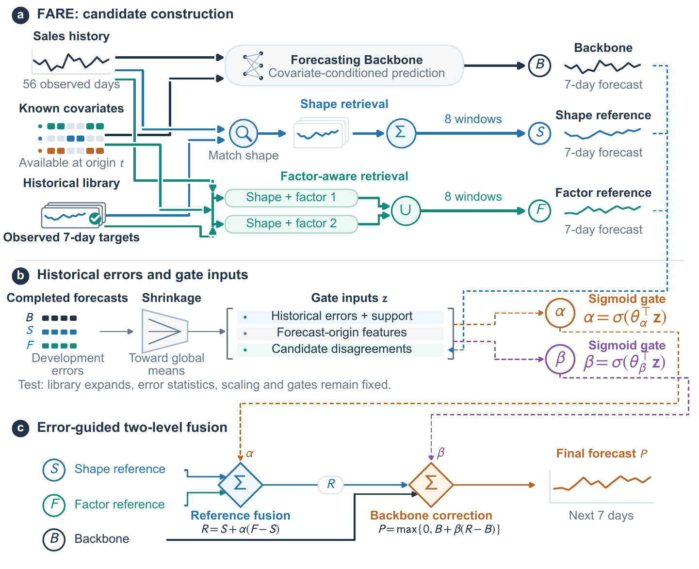

# FARE: Factor-Aware Retrieval with Error-Guided Fusion for Retail Forecasting

## Introduction

Retail demand is driven by known future factors such as promotions, holidays and calendar events, yet a single forecasting backbone often reacts to them poorly. FARE is a lightweight layer on top of any backbone forecast. It retrieves past weeks that resemble the query, builds reference forecasts from what followed them, and learns how far to move the backbone towards those references.

- **Two kinds of historical references.** A *shape* reference comes from past windows whose recent sales look like the query; a *factor* reference comes from past windows whose upcoming factor pattern matches the forecast week.
- **Two bounded gates.** One gate decides how to mix the two references; the other decides how strongly the mixed reference corrects the backbone.
- **Error-guided reliability.** Both gates see how accurate the backbone and each reference have been for that series in earlier, completed weeks. The calibration is frozen before testing.

<p align="center">

</p>

## Requirements

Use Python 3.10 or newer for the core method and Python 3.12 for the experiment environments:

```bash
python -m pip install -e .
python -m pip install -r configs/environments/retail.txt
```

Each experiment family has its own dependency file in `configs/environments/`; see [`docs/REPRODUCE.md`](docs/REPRODUCE.md).

## Datasets

Download [Favorita](https://www.kaggle.com/competitions/store-sales-time-series-forecasting/data), [M5](https://www.kaggle.com/competitions/m5-forecasting-accuracy/data), [Rossmann](https://www.kaggle.com/competitions/rossmann-store-sales/data) and [Rohlik V2](https://www.kaggle.com/competitions/rohlik-sales-forecasting-challenge-v2/data) from Kaggle and place them in `data/raw/{favorita,m5,rossmann,rohlik}/`.

## Usage

```bash
# FARE with a backbone on one dataset
bash scripts/fare/rossmann/chronos.sh --device cuda

# Comparison methods and controls, after the Chronos-2 run above
bash scripts/baselines/prepare_inputs.sh rossmann
bash scripts/baselines/conventional.sh --dataset rossmann
bash scripts/ablations/candidate_paths.sh rossmann
```

Launch scripts for every dataset, backbone, comparison method and ablation, together with the expected outputs, are listed in [`docs/REPRODUCE.md`](docs/REPRODUCE.md). Method details are in [`docs/METHOD.md`](docs/METHOD.md). Results are reported in the paper.

## Repository structure

```text
src/fare/        Core method: retrieval, error state, features and gate fusion
data_provider/   Dataset loaders and prepared panels
backbones/       Chronos-2, LightGBM, TFT, PatchTST and SparseTSF adapters
exp/             FARE experiment runners, built-in controls and scoring
baselines/       ETS, SARIMA, Ridge, XGBoost, LightGBM residual, RAF, TimeFuse, PFRP, PIR, SARAF
ablations/       Candidate-path controls, retrieval and error-estimation ablations, sensitivity
efficiency/      Runtime and memory measurement: cost table and library-size scaling
configs/         Experiment settings, environments and upstream sources
scripts/         Launch scripts: fare/, baselines/, ablations/, efficiency/
docs/            Method details and reproduction guide
figs/            Framework figure
```

## Acknowledgement

We thank the authors of the following repositories, whose code we build on or fetch for the comparisons: [Chronos](https://github.com/amazon-science/chronos-forecasting), [PatchTST](https://github.com/yuqinie98/PatchTST), [SparseTSF](https://github.com/lss-1138/SparseTSF), [TimeFuse](https://github.com/ZhiningLiu1998/TimeFuse), [PFRP](https://github.com/ddz16/PFRP), [PIR](https://github.com/ustc-time-series/PIR), [SARAF](https://github.com/ShiqiaoZhou/SARAF), [RAF](https://github.com/kutaytire/Retrieval-Augmented-Time-Series-Forecasting) and [Time-Series-Library](https://github.com/thuml/Time-Series-Library).

## License

Released under the MIT License. See [`LICENSE`](LICENSE).
